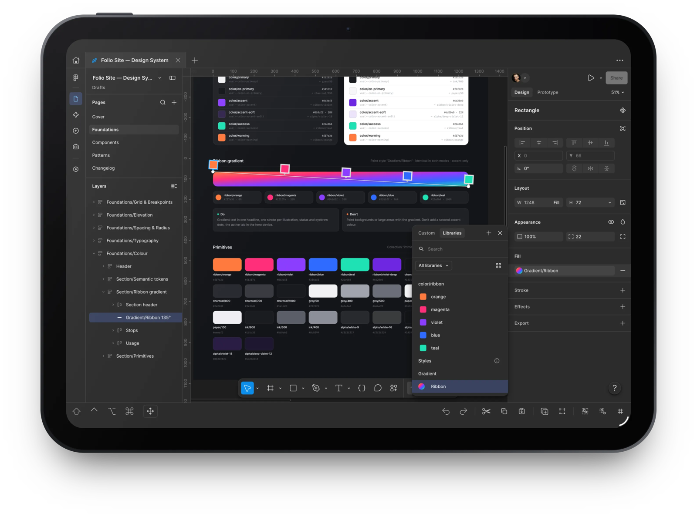

<div align="center">


# Folio for Figma

**Design on your iPad.** Figma, with the parts iPad was missing.

[](LICENSE) [](#requirements) [](https://foliodesign.app)

[Website](https://foliodesign.app) · [User guides](https://foliodesign.app/getting-started) · [Build from source](#build-from-source) · [Support](https://foliodesign.app/support)

<br>



</div>

Folio is a free, native iPad app that runs Figma's own web editor and adds what a browser tab can't. Your account, your files, nothing in between. It doesn't reimplement or modify Figma; it adapts iPad input to standard browser behaviour.

> [!NOTE]
> Folio 1.0 is [on the App Store](https://apps.apple.com/app/id6828007211) for iPad. iPhone support is an Alpha on TestFlight.

## Features

- **Tabs and windows**: open several files, pin tabs, reopen closed ones, and spread work across windows. Tabs come back on relaunch.
- **Apple Pencil and touch**: Pencil edits while a finger pans, or Touch Only turns a finger into the pointer. Hold menus and two-finger pan in both.
- **Trackpad and keyboard**: pinch or Ctrl-scroll to zoom the canvas, and keyboard commands for tabs, windows and settings.
- **Bottom toolbar**: Shift, Control, Option and Command keys, flick arrows, and Undo, Redo, Copy, Paste and more.
- **Interface zoom**: scale Figma's panels and Folio's chrome from 50% to 200%.
- **Downloads and exports**: a Download Center, Save to Files, Share, and exports straight to Photos.
- **Stays up**: unloads background tabs under memory pressure, recovers from crashes, and has a Safe mode.

## Requirements

- iPad with iPadOS 26 or later (iPhone with iOS 26 for the TestFlight Alpha).
- An internet connection and a Figma account. Sign in with email and password or SSO; Google sign-in doesn't work in embedded browsers.
- Optional: Apple Pencil, trackpad or mouse, and a hardware keyboard.

## Privacy

Folio talks to Figma directly. No proxy, no analytics, and it never handles your credentials. Settings and tabs stay on your device. Details in the [Privacy Policy](https://foliodesign.app/privacy).

## Build from source

You need a Mac with Xcode 27.0, XcodeGen, Node 22, pnpm 12.9.1 and Python 3, plus an Apple signing team to install on a device.

```sh
pnpm install --frozen-lockfile
pnpm typecheck && pnpm lint && pnpm test
swift format lint -r apps/ios
xcodegen generate --spec apps/ios/project.yml
```

Open `apps/ios/Folio.xcodeproj` and run the Folio scheme on your iPad. No signing team is included: set your own team, and change the bundle IDs and the App Group together in `apps/ios/project.yml`, both entitlements files and `apps/ios/Shared/FolioLink.swift`. The `app.foliodesign.folio` IDs belong to the App Store app. After changing `packages/compat`, run `pnpm build`.

| Path | Contents |
| --- | --- |
| [`apps/ios`](apps/ios) | The iPadOS app, Share extension and tests (Swift 6, UIKit, WebKit) |
| [`packages/compat`](packages/compat) | TypeScript input adaptations injected into the editor |

Ground rules in the code: public Apple APIs first, standard browser events only, and never modify Figma's code, add a proxy or handle credentials.

## Contributing

Issues are welcome; outside pull requests are not accepted for now. See [CONTRIBUTING.md](CONTRIBUTING.md) and, for security problems, [SECURITY.md](SECURITY.md).

## Legal

Source code under [Apache-2.0](LICENSE) (see [NOTICE](NOTICE)). The Folio name and icon are not covered by the license. [Terms](https://foliodesign.app/terms) · [Privacy](https://foliodesign.app/privacy) · [Legal notice](https://foliodesign.app/legal) · [Support](https://foliodesign.app/support)

<sub>Folio is an independent app and is not affiliated with, endorsed by, or sponsored by Figma, Inc. Figma is a trademark of Figma, Inc., used only to describe compatibility. iPad, iPhone, Apple Pencil and App Store are trademarks of Apple Inc.</sub>
